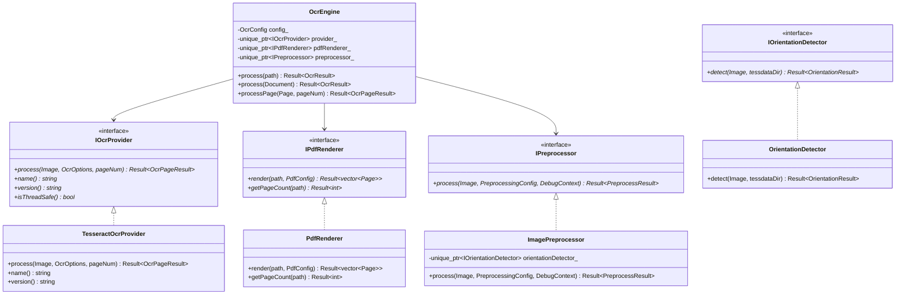

# OCR-DI Architecture Overview

## 1. System Context & Vision

OCR-DI is an education-focused Document Intelligence platform designed to ingest complex academic credentials (transcripts, marksheets, degree certificates, syllabi, transfer credit forms) and extract structured, actionable data for downstream evaluation, course matching, and analytics.

The **C++ OCR Engine v0.1** represents the foundational processing core of OCR-DI.

```text
External Applications / Webhooks / Batch Pipelines
                      │
                      ▼
               EDMO Ingestion API
                      │
                      ▼
          OCR-DI Engine (C++20)
                      │
                      ▼
             Normalized OCR JSON
                      │
                      ▼
         Downstream Document Intelligence
         (LayoutLM, Table Extraction, Field Matching)
                      │
                      ▼
           Structured Education JSON
```

---

## 2. Core Architectural Principles

1. **OCR as an Extensible Pipeline**: OCR is not a single opaque function call; it is a sequenced pipeline of validation, rendering, geometry normalization, enhancement, inference, hierarchy reconstruction, and serialization.
2. **Pluggable Model Provider Boundary (`IOcrProvider`)**: The engine orchestrator interacts exclusively with abstract provider interfaces. Tesseract is the v0.1 reference provider, but ONNX, PaddleOCR, OpenVINO, or custom EDMO neural networks can be swapped without touching core orchestration.
3. **Preservation of Raw Evidence**: Extracted text preserves raw character tokens, bounding boxes, geometry, lines, and blocks alongside normalized text. No character transformations are destructive.
4. **Hierarchical Document Model**: Documents are modeled as `Document -> Page -> Block -> Line -> Token` with explicit bounding boxes and normalized confidence scores (0.0 to 1.0).
5. **Memory and Concurrency Safety**: Uses modern C++20 RAII, smart pointers, zero raw owning pointers, and thread-confined provider instances suitable for multi-worker thread pools.

---

## 3. Class & Component Diagram



---

## 4. Future ML & GPU Integration Path

In future releases, the model factory can instantiate backends targeting ONNX Runtime, TensorRT, or PaddleOCR without modifying API boundaries:

```text
                           OcrEngine Orchestrator
                                     │
                    ┌────────────────┴────────────────┐
                    │                                 │
           IOcrProvider (CPU)                IOcrProvider (GPU)
                    │                                 │
            TesseractOcrProvider              OnnxModelProvider
             (Leptonica / OSD)              (CUDA / TensorRT / DML)
```
